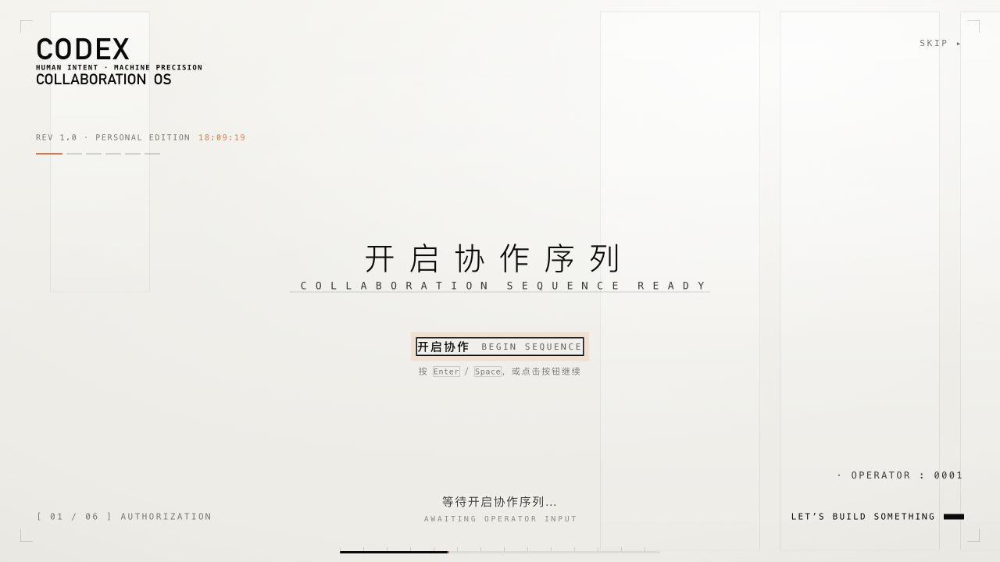

# codex-startup-screen

为 Codex 定制的一段交互式启动动画：黑幕终端标识 → 过曝洗白 → 暖白技术档案 → 两次确认 → 扫描与进度序列 → 欢迎与色散故障揭幕。

基于 [6shenhonghong9/dsh-startup-screen](https://github.com/6shenhonghong9/dsh-startup-screen) 改编，保留上游的视觉结构与 MIT 署名，换上 Codex 文案、原创 `>_` 终端图形和协作序列。**个人非官方项目，与 OpenAI 没有隶属或背书关系。**



**[在线预览](https://yanyadua.github.io/codex-startup-screen/?quiet=1)** · [配置说明](docs/CONFIG.md) · [macOS 接入与恢复](docs/MACOS.md) · [实现与验证](docs/ARCHITECTURE.md)

## 先看动画

直接打开仓库中的 `index.html`，或用 Python 启动本地服务。动画本身没有第三方运行依赖，不需要安装 npm 包，也不需要 API key。

```bash
git clone https://github.com/Yanyadua/codex-startup-screen.git
cd codex-startup-screen
python3 -m http.server 8766 --bind 127.0.0.1
```

浏览器打开 <http://127.0.0.1:8766/?quiet=1>。前两步点击按钮，或按 Enter / 空格继续；右上角 Skip 和 Esc 可跳过。结束后可以重播或切换全自动。

| 阶段 | 显示内容 | 操作 |
| --- | --- | --- |
| 开场 | 黑底 `>_` 与 CODEX | 自动 |
| 01 | 开启协作序列 | 点击 / Enter / 空格 |
| 02 | 确认工作代号 | 点击 / Enter / 空格 |
| 03 | 建立协作通道 | 自动 |
| 04 | 展开工作空间 | 自动 |
| 05–06 | 序列就绪、欢迎与揭幕 | 自动 |

这些文字属于视觉叙事，不执行身份验证、权限授予、会话建立或工作区索引。

## 能改什么

编辑 [`lib/config.js`](lib/config.js) 可修改代号、编号、品牌文案、配色、深浅主题、播放速度和音效。默认使用代码合成的轻音效，首次实际交互前保持静音；语音默认关闭。仓库不包含上游视频中的人声或音效文件。

`?quiet=1` 静音，`?auto=1` 全自动，`?fast=1` 加速；参数可以组合。检测到系统“减少动态效果”偏好时，会自动加速并取消两次等待确认；对动画敏感的用户可直接按 Esc。

## 接入 Codex 桌面版

本仓库同时提供 macOS 的**实验性应用补丁源码**。它使用 Electron 首屏覆盖层，在首个主窗口播放一次，完成后让原界面继续显示；它不是 Codex 官方插件 API。

目前仅适配 **Apple Silicon macOS、`com.openai.codex`、26.1013.40934 / build 20770、`/Applications/ChatGPT.app`**。构建器还会核对原始 ASAR 指纹，不匹配就停止；其他版本、Windows 和 Linux 尚未适配。浏览器预览没有这项限制。

```bash
# 仅构建本地副本与备份，不退出或替换当前应用
python3 tools/macos/prepare.py
```

正式应用替换、恢复命令和签名影响详见 [macOS 接入与恢复](docs/MACOS.md)。修改应用需要重新签名，无法保留 OpenAI 的原厂代码身份；登录、钥匙串、应用组、通知与系统权限行为可能受影响。官方更新也可能覆盖补丁。

## 源码结构

```text
index.html, preview.js       独立浏览器预览
lib/                        动画、样式、默认配置
integration/electron/       主窗口覆盖层引导代码
tools/macos/                构建、ASAR 校验、签名与替换/恢复源码
test/                       引导生命周期与损坏归档回归测试
docs/                       配置、接入说明、验证范围与预览图
```

运行 `npm run check` 和 `npm test` 可检查源码；测试无需安装依赖，需要 Node.js 20+ 与 Python 3.9+。macOS 原生构建另外需要 Apple Command Line Tools 和本机合法安装的匹配版本应用。仓库不分发 Codex 安装包、官方应用资源、个人配置或聊天数据。

## 致谢与许可

上游：[dsh-startup-screen](https://github.com/6shenhonghong9/dsh-startup-screen)，参考提交 `8ec3132e69f0906b3ed2f7eb083b1035cd69c1d4`，MIT © 2026 沈宏宏。动画主体的编排、布局和大量实现来自上游；本项目不是完全从零创作。Codex 适配与新增工具由 Yanyadua 维护。

代码按 [MIT License](LICENSE) 发布，保留上游版权声明；第三方品牌与商标归各自权利人所有。许可证不授予第三方素材、商标或视觉作品的额外权利。上游对第三方视频素材的说明见其 README；本仓库不复制那些音频文件。
